# Rapport TP – Mise en place du protocole SSH

**Binôme : Karol Birane Fall et Oumy Traoré – L3 GLSI – 18 novembre 2026**

| | |
|---|---|
| **Établissement** | DGI-ESP / UCAD |
| **Classe** | L3 GLSI |
| **Module** | Services Réseaux Avancés |
| **Enseignant** | Dr. GUEYE |
| **Binôme** | Karol Birane Fall et Oumy Traoré |
| **Année** | 2026-2027 |

---

## Présentation

Toutes les étapes du TP ont été réalisées avec succès : installation d'un serveur SSH, connexion à distance, authentification par clés sans mot de passe, et tunnels SSH vers un serveur web et une base de données.

**Objectif :** comprendre comment utiliser SSH pour sécuriser l'accès à une machine distante.

## Environnement de travail

Le TP a été réalisé avec trois machines : un serveur Ubuntu et deux clients macOS.

| Machine | Rôle | Système | Adresse IP |
|---|---|---|---|
| VM Ubuntu (`karolfall`) | Serveur SSH, Apache, MariaDB | Ubuntu 26.04.1 LTS | 192.168.64.18 (local), 100.108.62.35 (Tailscale) |
| MacBook Air de Karol | Client des étapes 2 et 4 | macOS | 192.168.64.1 |
| MacBook d'Oumy (`macbook-doumy`) | Client de l'étape 3 | macOS 15.5 | 100.93.33.66 (Tailscale) |

**Adaptations par rapport au sujet :**

- **macOS au lieu de Windows et de Linux pour les clients** : macOS intègre le client et le serveur OpenSSH, donc les commandes restent identiques.
- **Tailscale** : les deux membres du binôme n'étaient pas sur le même réseau. Tailscale crée un réseau privé virtuel (adresses en `100.x.x.x`) qui relie les machines à distance.
- **Clé ED25519 au lieu de RSA** : algorithme plus récent, avec des clés plus courtes et plus sûres.
- **Clé publique transmise par messagerie au lieu de `scp`** : cela évite de communiquer le mot de passe de session d'Oumy (voir étape 3).

---

## Étape 1 – Installation du serveur SSH

Le serveur OpenSSH est installé, actif au démarrage et à l'écoute sur le port 22.

```bash
sudo apt update
sudo apt install openssh-server
sudo systemctl enable ssh
sudo systemctl start ssh
sudo systemctl status ssh
```

Le service affiche `active (running)` et `enabled` : il redémarrera automatiquement avec la machine.

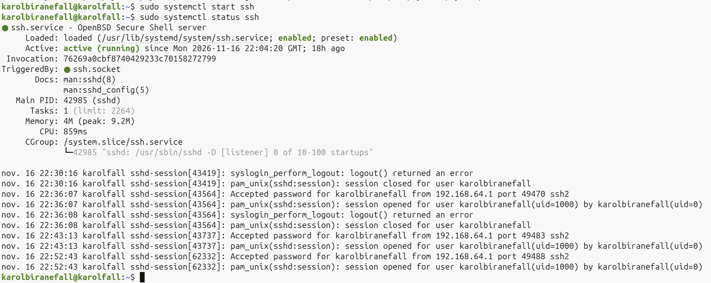

*Figure 1 – État du service SSH sur le serveur*

On vérifie ensuite le port et le pare-feu :

```bash
sudo ss -tlnp | grep :22
sudo ufw status
```

Le processus `sshd` écoute sur `0.0.0.0:22` (IPv4) et `[::]:22` (IPv6). Le pare-feu `ufw` est inactif, donc aucune règle n'est nécessaire.

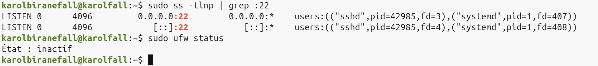

*Figure 2 – Port 22 ouvert et état du pare-feu*

---

## Étape 2 – Connexion SSH depuis le client

Le client macOS se connecte au serveur avec le compte `karolbiranefall` et son mot de passe.

```bash
ssh karolbiranefall@192.168.64.18
```

À la première connexion, le client demande de confirmer l'empreinte du serveur, puis le mot de passe. L'invite devient `karolbiranefall@karolfall:~$` : les commandes tapées sur le Mac s'exécutent désormais sur le serveur Ubuntu, à travers une connexion chiffrée.

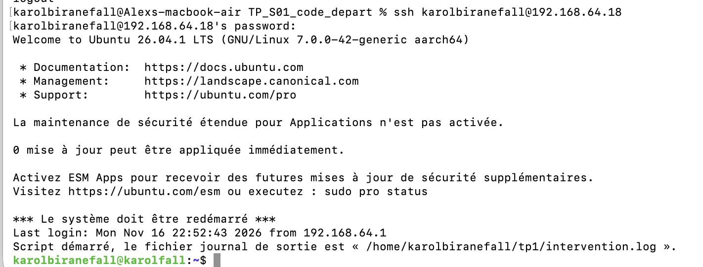

*Figure 3 – Connexion du client macOS au serveur SSH*

---

## Étape 3 – Authentification par clés SSH

Le serveur se connecte au Mac d'Oumy sans mot de passe, grâce à une paire de clés. Le principe : la clé publique est déposée sur la machine distante, et seule la machine qui détient la clé privée correspondante peut s'y connecter.

### 3.1 Génération de la paire de clés sur le serveur

```bash
ssh-keygen -t ed25519
```

Deux fichiers sont créés dans `~/.ssh` : `id_ed25519`, la clé **privée**, qui ne quitte jamais le serveur, et `id_ed25519.pub`, la clé **publique**, que l'on peut partager.

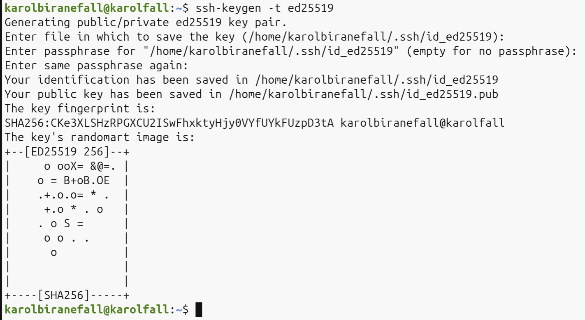

*Figure 4 – Génération de la paire de clés ED25519*

```bash
ls -a ~
cd ~/.ssh
ls
cat id_ed25519.pub
```

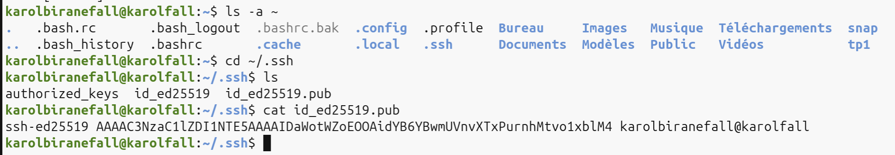

*Figure 5 – Présence du dossier .ssh et contenu de la clé publique*

### 3.2 Mise en réseau avec Tailscale

Tailscale a été installé sur le serveur, puis Oumy a partagé son Mac dans le réseau Tailscale de Karol. Le serveur joint alors le Mac d'Oumy à l'adresse 100.93.33.66 : `ping -c 4 100.93.33.66` renvoie 4 réponses sur 4, sans perte.

```bash
curl -fsSL https://tailscale.com/install.sh | sh
sudo tailscale up
```

### 3.3 Installation de la clé publique sur le Mac d'Oumy

Le sujet utilise `scp`, qui demande le mot de passe de la machine cliente. Pour ne pas communiquer ce mot de passe, la clé publique a été envoyée à Oumy par messagerie, ce qui ne présente aucun risque. Oumy l'a ajoutée elle-même au fichier des clés autorisées :

```bash
mkdir -p ~/.ssh
echo "ssh-ed25519 AAAA... karolbiranefall@karolfall" >> ~/.ssh/authorized_keys
chmod 700 ~/.ssh
chmod 600 ~/.ssh/authorized_keys
```

Les droits `700` et `600` sont obligatoires : SSH refuse un fichier `authorized_keys` lisible par d'autres utilisateurs.

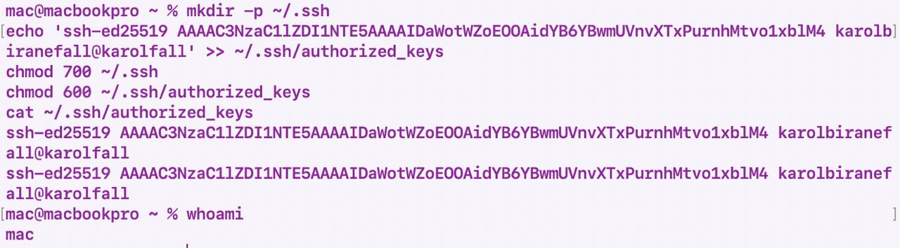

*Figure 6 – Ajout de la clé publique dans authorized_keys (Mac d'Oumy)*

### 3.4 Test de connexion sans mot de passe

```bash
ssh mac@100.93.33.66
```

La session s'ouvre directement sur `mac@macbookpro ~ %`, **sans demande de mot de passe** : l'authentification par clé fonctionne.

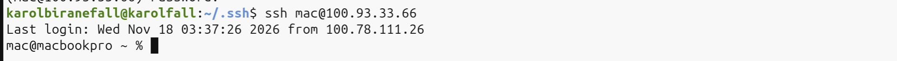

*Figure 7 – Connexion du serveur au Mac d'Oumy sans mot de passe*

---

## Étape 4 – Tunnel SSH

Le site web et la base de données du serveur sont accessibles depuis le Mac uniquement à travers SSH. Un tunnel (`ssh -L`) redirige un port local du client vers un port du serveur : le trafic HTTP ou MariaDB circule chiffré à l'intérieur de la connexion SSH, et seul le port 22 est utilisé sur le réseau.

### 4.1 Préparation du serveur

```bash
sudo adduser mame
sudo apt install apache2
curl -s http://127.0.0.1 | grep -i title
```

Le compte `mame` sert à ouvrir le tunnel. Apache est actif et répond localement avec sa page par défaut « It works ».

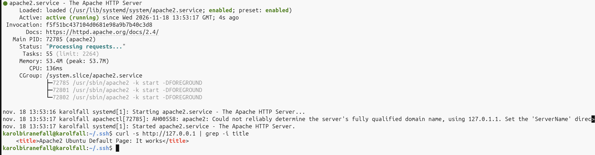

*Figure 8 – Service Apache actif sur le serveur*

### 4.2 Tunnel vers le serveur web

Depuis le Mac :

```bash
ssh -L 1024:127.0.0.1:80 mame@192.168.64.18
```

Le port **1024 du Mac** est relié au port **80 (Apache) du serveur**.

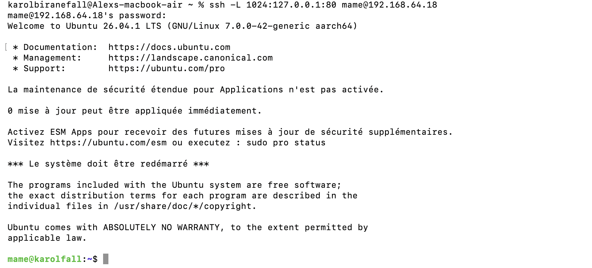

*Figure 9 – Ouverture du tunnel SSH vers le port 80*

Dans le navigateur du Mac, l'adresse `http://localhost:1024` affiche la page Apache du serveur : le navigateur ne contacte que le Mac lui-même, et la requête passe par le tunnel.

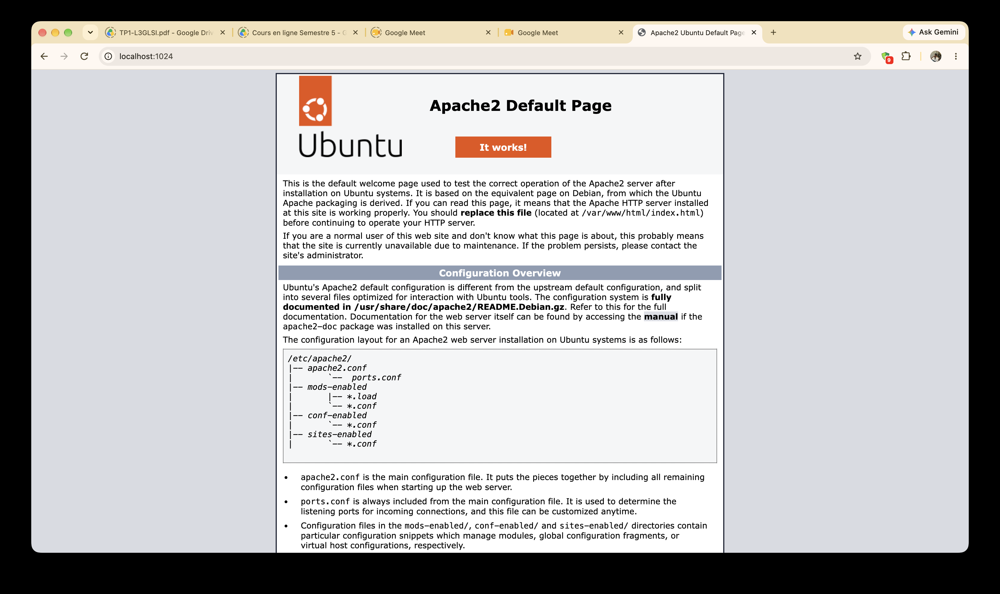

*Figure 10 – Page web du serveur affichée via localhost:1024*

### 4.3 Tunnel vers la base de données

MariaDB a été installé sur le serveur, avec une base `tp_ssh`, une table `etudiants` et un utilisateur dédié `tp`. Le compte `root` de MariaDB n'accepte pas les connexions réseau, d'où ce compte séparé.

```bash
sudo apt install mariadb-server
sudo mariadb -e "CREATE DATABASE tp_ssh;
CREATE USER 'tp'@'localhost' IDENTIFIED BY 'tp123';
GRANT ALL ON tp_ssh.* TO 'tp'@'localhost';
CREATE TABLE tp_ssh.etudiants (nom VARCHAR(50));
INSERT INTO tp_ssh.etudiants VALUES ('Karol'), ('Oumy');"
```

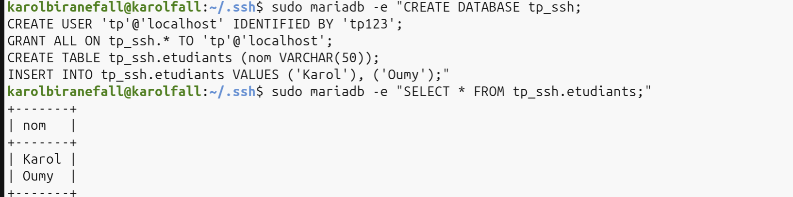

*Figure 11 – Création de la base de test sur le serveur*

Depuis le Mac, un second tunnel relie le port **3307 local** au port **3306 (MariaDB) du serveur**, puis le client MariaDB se connecte au port local :

```bash
ssh -L 3307:127.0.0.1:3306 mame@192.168.64.18
mariadb -h 127.0.0.1 -P 3307 -u tp -p
```

La ligne `Server version: 11.8.6-MariaDB-5ubuntu0.1 from Ubuntu` confirme que le Mac interroge bien la base du serveur. La requête `SELECT * FROM tp_ssh.etudiants;` renvoie les deux lignes Karol et Oumy.

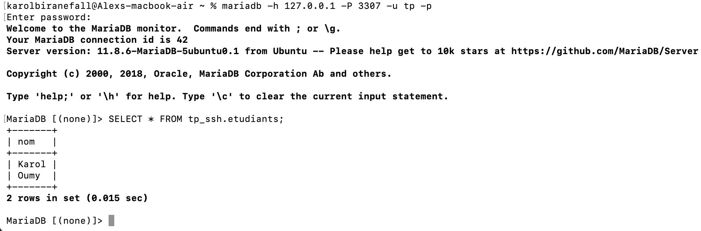

*Figure 12 – Accès à la base du serveur depuis le Mac via le tunnel*

---

## Difficultés rencontrées

| Problème | Cause | Solution |
|---|---|---|
| `apt update` refuse les dépôts (« pas encore valable ») | Horloge de la VM en retard après une mise en veille | Heure corrigée avec `date -s`, puis `chrony` configuré (`makestep 1 -1`, `nocerttimecheck 1`) pour se resynchroniser au démarrage |
| Binôme sur un réseau différent | Pas de réseau local commun | Réseau privé virtuel Tailscale, avec partage du Mac d'Oumy |
| `scp` demande le mot de passe du Mac d'Oumy | Authentification par mot de passe requise pour la copie | Clé publique envoyée par messagerie et ajoutée à la main dans `authorized_keys` |
| `Access denied` pour l'utilisateur `tp` via le tunnel | Mot de passe de `tp` mal enregistré | Mot de passe redéfini sur le serveur avec `ALTER USER` |

## Conclusion

Ce TP montre les trois usages principaux de SSH : administrer une machine à distance par une connexion chiffrée, s'authentifier par clés sans transmettre de mot de passe, et faire passer d'autres protocoles (HTTP, MariaDB) dans un tunnel sécurisé en n'exposant que le port 22. Les adaptations faites (macOS, Tailscale, transmission de la clé publique hors `scp`) n'ont pas changé les principes du sujet ; elles montrent que SSH fonctionne de la même façon sur tous les systèmes et à travers des réseaux distants.
